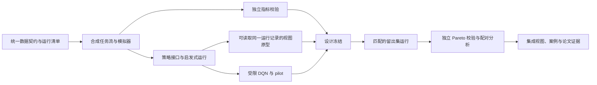

# Topic 3 项目行动计划

> 本计划依据 `Topic3_Interactive_Visualization_Research_Proposal_Revised.md` 及团队随后确认的范围编写。它规定任务依赖、交付物和验收条件，不为单项任务设定预计周次或完成时长。计划获确认后才按任务实施；本文档本身不表示模拟、训练、实验或界面已经完成。

## 1. 目标、边界与完成定义

项目的核心成果是**可追溯的交互式三目标权衡分析**：在相同、冻结的边缘—云任务流上比较调度结果，让每个可视化点都能回到运行记录和任务事件，并准确区分二维投影与完整三维空间中的 Pareto 状态。调度器、模拟器和一个受限训练的 DQN 为此提供可比较数据，不构成新的调度或强化学习算法贡献。

### 固定研究边界

- 主要目标均为最小化：总完成时间 $M$、建模的任务相关计算加传输能耗 $E$、平均端到端任务延迟 $L$。设备和网络持续空闲基线能耗不计入 $E$。
- 一个 Pareto 比较集合只包含**同一冻结任务实例**上的候选运行；默认集合为六种预先声明的启发式配置和一个固定 DQN。不同任务流或负载强度不能合成一个前沿。
- 启发式为 Random、Latency-first、Energy-first，以及 Balanced 的等权、偏重 makespan、偏重 energy 三种配置；Balanced 的三种权重属于同一方法族。
- 只训练一个 DQN：初步网络为两层各 64 单元，一个记录的训练种子，最多 500 个完整的 80 任务训练回合，即最多 40,000 次放置决策。不得根据留出集结果反复调参或选择有利的 checkpoint。
- 三种 3B 编码均纳入基础成果：散点图矩阵、平行坐标、简洁的同数据 3D 参考视图。3D 旋转等增强功能不是基础验收条件。
- 不招募外部受试者或领域专家；验证结论限定于计算正确性、交互一致性、可复现案例和所测试配置的模拟结果。
- 提案中的拓扑、任务分布、链路速度和每档 12 条留出任务流均为**暂定设计**。只有 pilot 证据和设计冻结记录能将它们转成正式实验参数。

### 项目完成时应能交付

1. 可重放的合成任务流、受控模拟器、七种固定配置的运行记录及完整事件日志。
2. 三个成对散点图、散点图矩阵、平行坐标和简洁 3D 视图；所有视图共享运行 ID、单位、选中状态和明确的筛选语义。
3. 独立重算的指标及 Pareto 校验、可复现的脚本化分析案例、配对比较结果和明确的失败记录。
4. 版本化参数清单、训练记录及 checkpoint、种子清单、复现说明和分别可归属的 3A/3B 成果证据。

## 2. 工作组织与依赖

| 工作流 | 主要责任 | 共同接口 |
| --- | --- | --- |
| 3A：成对视图、二维投影标记和支配证据 | 成员 A | 读取统一的 `RunRecord` 与 Pareto 结果；提供可复用的散点图组件、witness 详情和二维/三维分歧案例 |
| 3B：散点图矩阵、平行坐标、紧凑 3D 视图 | 成员 B | 读取同一批记录；矩阵复用 3A 散点图组件，独立负责三种视图的设计与检查 |
| 跨视图共享层：选择、筛选、坐标与集成 | 成员 A、B 共同 | 共同定义并实现状态接口，保证 3A/3B 使用相同的运行 ID、可见性、轴域及 Pareto 参照集合 |
| 3C：模拟、策略、实验、校验和分析 | 两名成员共同 | 提供冻结实例、事件日志、运行结果和独立校验结果 |

两人共同评审数据契约、实现共享界面状态并完成跨视图集成验收；共享状态不是成员 B 单独承担的工作。成员 A 重点负责支配证据详情、二维与三维状态分歧案例和 3A 验证，成员 B 重点负责三种 3B 视图。各自保存视图设计、检查案例和结果说明，使个人贡献可分别陈述。原型形成后，两人根据实际技术难点调整共同 3C 工作的具体分担，但不改变固定研究范围。完成顺序由**依赖和验收结果**决定：某项工作通过其验收后，下游工作即可继续；没有逐项日历时限。

## 3. 建议的技术与文件组织

优先使用一个 Python 项目完成任务生成、模拟、训练、分析和数据导出，避免在原型阶段同时维护多套后端。事件和运行结果使用带版本号的 JSON/JSONL 文件，便于逐条审计；正式结果量较小时不需要数据库。可视化可先评估 Python Dash/Plotly 对散点图矩阵、平行坐标和 3D 视图的事件支持；**在选定界面库之前，应以七条样例运行验证跨视图 ID 选择、平行坐标筛选和 3D 选择能否一致实现**。如果某种事件无法可靠取得，允许只替换该视图的绘制层，不改变共享数据契约或 Pareto 计算。

以下为实施时建议创建的职责边界；文件名可在不改变接口含义的前提下细化，并在变更记录中说明。

| 路径 | 单一职责 |
| --- | --- |
| `docs/data_contract.md` | 字段、单位、ID、文件格式、状态和版本规则 |
| `src/topic3/contracts.py` | 任务、实例、事件、运行、策略观察的类型和校验 |
| `src/topic3/workload.py` | 根据配置和种子生成并保存冻结任务流 |
| `src/topic3/simulator.py` | FIFO 传输/计算事件及完整任务日志 |
| `src/topic3/policies.py` | 共享策略接口和六种启发式配置 |
| `src/topic3/metrics.py` | 从事件日志独立重算 $M$、$E$、$L$ |
| `src/topic3/pareto.py` | 供视图与分析使用的二维/三维支配与 witness 计算 |
| `tests/reference_pareto.py` | 与正式 Pareto 模块分离的候选对枚举校验 |
| `src/topic3/dqn.py` | 单个 DQN 的训练、checkpoint 保存和冻结推理 |
| `src/topic3/experiment.py` | 清单驱动的运行、失败记录和结果导出 |
| `src/topic3/analysis.py` | 配对差、分档摘要和案例查询 |
| `app/` | A、B 共同维护选择/筛选/坐标状态；A 负责可复用散点图与支配证据详情，B 负责散点图矩阵、平行坐标和 3D 视图 |
| `tests/` | 指标、模拟、Pareto、数据契约及界面行为检查 |
| `configs/` | pilot 配置、候选配置和冻结设计清单 |
| `artifacts/` | 生成的实例、事件日志、checkpoint 和结果；按清单可重建，不手工修改原始记录 |

依赖库及其版本应在首次采用时记录在项目配置和锁定文件中。可视化技术的选择以能否满足联动与导出检查为准，不因单个库的默认图表样式改变研究问题。

## 4. 共享数据契约与接口先行

**责任：两名成员共同。前置条件：无。产物：`docs/data_contract.md`、类型定义、样例实例与样例运行。**

先定义如下数据对象及其字段，再并行开发视图和策略：

- `WorkloadInstance`：`instance_id`、强度标签、环境/任务生成种子、完整任务列表、拓扑与参数清单版本。任务至少包含 `task_id`、到达时间（秒）、计算量（cycles）、上传字节数和返回字节数。
- `TaskEvent`：关联 `instance_id/run_id/task_id`、目的节点、上传/计算/返回各阶段的开始与结束、完成时间、计算能耗、传输能耗及状态。就地节点的传输字段使用明确的“不适用”表示，不伪造网络耗时。
- `RunRecord`：`run_id`、`instance_id`、策略配置 ID、策略随机种子、模拟器版本、DQN checkpoint 标识（适用时）、完成状态、失败原因、任务数及完整运行的 $M/E/L$。
- `ExperimentManifest`：拓扑、容量、能耗常数、队列与传输规则、任务分布、种子划分、策略参数、软件版本、数值容差和原始数据路径。修改后产生新版本，不覆写旧版运行的依据。

所有数值字段写明单位；时间内部统一为秒，数据量内部统一为字节，能耗统一为焦耳。MB 的换算口径要在契约中明定。ID 应由稳定输入确定或由稳定清单映射，且在一次项目归档中不可重用；禁止同一 `run_id` 指向不同实例或配置。

策略接口的约定是 `choose(task, observable_state) -> destination_id`：只能看见已到达任务、当前队列和由此计算的预测特征，不传入未来任务。模拟器通过同一接口调用 Random、Latency-first、Energy-first、三种 Balanced 配置和 DQN。运行接口的约定是 `run_instance(frozen_instance, fixed_policy, manifest) -> event_log + run_record`；一次运行失败也必须返回可追踪的状态与原因。

**验收：**一条样例任务和一条样例运行可按契约读写；类型、单位和引用关系通过校验；重复 ID、缺字段和单位不合法会被拒绝。成员 A、B 均可仅依契约制作视图样例，不需要读取模拟器内部状态。

成员 A、B 还需共同约定界面状态接口：当前 `instance_id`、选中的 `run_id` 集合、可见策略配置、各轴显示范围，以及明确的完整实例 Pareto 参照集合。状态的存储和更新由两人共同实现；各自的视图只通过这套接口读写状态。用七条样例运行检查实例切换会清除无效选择、筛选不改变支配标签、轴域变化有明确提示。

## 5. 按依赖推进的工作包

### P1. 冻结任务流生成与重放

**责任：3C 共同。依赖：共享数据契约。产物：生成器、实例文件、训练/pilot/留出集种子清单。**

- 用记录的种子生成到达时间、计算量、上传和返回量；同一实例文件提供给所有配置，不在策略运行时重新采样。
- 训练、pilot、留出集的实例 ID 和种子集合必须互不相交。开始正式评价前只允许根据 pilot 结果修改暂定分布和规模，并记录理由。
- **验收：**相同清单重放得到相同任务序列；不同策略读取的 `instance_id`、任务数和任务内容完全一致；种子碰撞检查通过。

### P2. 离散事件模拟器与最小策略链路

**责任：3C 共同。依赖：P1。产物：模拟器、Random 与 Latency-first 两个最初配置、完整事件日志。**

- 实现三个异构边缘节点、一个云节点和网关共址节点；任务到达时决定唯一目的地；传输与计算 FIFO，无抢占、改派或未来信息。
- 非本地任务完成顺序为上传、计算、适用的返回传输；所有任务完成后运行才有完整结果。计算能耗按声明的相对空闲功率增量与计算时长计，传输能耗按声明的非本地上传/返回数据量和链路能耗参数计；两项分别记录，排除连续空闲基线。
- **验收：**固定实例及策略种子重放得到相同事件序列；本地任务无传输，远端任务不会在返回传输前完成；排队与节点速度变化能解释日志中的完成时间。超时或未完成运行有失败记录，不产生伪造的目标值。

### P3. 独立指标重算与原型纵向切片

**责任：3C 负责指标，两名成员共同检查视图输入。依赖：P2。产物：独立计算器、初始导出文件、一条从任务流到图上点的可运行路径。**

- 从归档日志独立计算 $M=\max c_i-\min a_i$、$L=\sum(c_i-a_i)/N$ 和 $E=\sum(E_{compute,i}+E_{transfer,i})$；计算器不得调用模拟器汇总结果的内部函数。
- 使用同一批运行记录做最简图表：至少能看到一个实例的点、数值、策略标签和对应 `run_id`，并从点打开任务记录。完整的视图编码与交互留给 P6、P7。
- 用七条样例运行验证候选界面库能否稳定传递选中 ID、平行坐标筛选事件和 3D 选中状态，并记录选用的绘制方式；此项验证不依赖最终七种策略均已实现。
- **验收：**本地、上传与返回、排队、速度不等、最晚完成、未完成、重复 ID 的固定样例均有预期输出或明确错误；图上显示值与独立重算一致。这是原型和数据管线 v1 的最低完成门槛。

### P4. 补齐六种启发式并固定共同接口

**责任：3C 共同。依赖：P2、P3。产物：Random、Latency-first、Energy-first、Balanced 三种权重配置及配置清单。**

- Balanced 的预测分数包含 makespan 增量、任务能耗和任务延迟；归一化尺度只能来自训练或 pilot 数据。三套权重分别为 `(1/3,1/3,1/3)`、`(0.6,0.2,0.2)`、`(0.2,0.6,0.2)`。
- 明确预测量、可行目的地和并列分数的固定处理规则。配置 ID 必须区别三种 Balanced 权重，但分析中仍标注它们属于同一方法族。
- **验收：**六种配置均能通过同一策略接口处理同一冻结实例；所有决策仅使用当时可观察状态；配置与策略种子可从运行记录追溯。

### P5. Pareto 参照集合与独立校验

**责任：3C 共同实现分类器；成员 A 牵头核对二维/三维分歧样例和供视图使用的 witness 字段。依赖：P4。产物：二维/三维分类器、witness 记录和独立枚举校验。**

- 对同一实例的七个预声明候选、同一组最小化目标，用未四舍五入的存储值和预先声明的容差计算支配。完全相同的向量互不支配。失败候选保留在失败清单中，不伪造向量参与数值前沿。
- 每个投影的分类独立于三维分类；筛选只影响可见性，不改变默认七候选参照集合。若以后支持可见子集重算，必须另加明确标签。
- **验收：**严格支配、完全相等、某轴相等及“二维被支配而三维非支配”的手工样例通过。第二套枚举实现与正式结果的状态及选定 witness 一致；不同实例绝不进入同一前沿。

### P6. 3A 成对视图

**责任：成员 A；与成员 B 共同使用和验收共享界面状态。依赖：P3、P5。产物：可供矩阵复用的散点图组件、三幅成对散点图、投影非支配标记、独立三维状态标记、witness 详情及分歧案例记录。**

- 三幅图分别使用 $M$–$E$、$M$–$L$、$E$–$L$；坐标展示单位和最小化方向，同一策略维持一致的颜色、形状与文字图例。
- 选中被支配运行时显示原运行与证据运行的完整目标值、比较维度及参照集合。投影状态与三维状态不能合并成一个含糊的标记。
- 将成对散点图的点、编码、tooltip 与选择事件整理成成员 B 可复用的组件接口；在至少一幅成对图中提供区域 brush，并将选中的 ID 写入 A、B 共同实现的状态接口。
- **验收：**图上点数、ID、单位和状态与存储记录一致；对预设二维/三维不一致样例能够显示正确原因和有效 witness；brush/点击可被 3B 视图接收，复用组件不导致矩阵中的运行 ID 或数值改变；成员 A 保存独立的设计和检查结果说明。

### P7. 3B 协同视图

**责任：成员 B；与成员 A 共同实现共享状态及跨视图验收。依赖：P3、P5；平行坐标和 3D 原型可与 P6 并行，矩阵集成依赖 P6 的可复用散点图组件。产物：散点图矩阵、平行坐标和简洁 3D 参考视图。**

- 所有视图读取同一记录和 `run_id`；散点图矩阵尽量复用 P6 的散点图组件，而不是重复实现三组点、编码和选择逻辑。成员 B 把三种视图接入 A、B 共同维护的状态接口，使 P6 的 brush 结果和各视图的手动选择在所有视图同步高亮。实例切换和策略筛选保持 ID 与可见数量一致；切换实例后清除不属于新实例的选择。
- 筛选不得悄悄改变完整七候选参照集合、坐标单位或轴域。3D 基础视图只需展示相同三目标与联动选中状态，不把旋转或复杂导航设为必须功能。
- 以相同分析案例记录三种编码对成对权衡、三目标联合模式、运行识别和遮挡的作用与限制，不提出未经受试者验证的感知优劣排序。
- **验收：**在各视图执行可用的选择/筛选后，同一 `run_id` 对应同一数值与导出行；A 的 brush 和 B 视图的选择均能跨视图同步；tooltip、轴标签、可见数量和参照集合标签正确；成员 B 保存独立的设计和检查结果说明。

### P8. 一个受限 DQN 与奖励账本

**责任：3C 共同。依赖：P2、P4；正式训练和最终评价另依赖 P9 的冻结清单。产物：训练脚本、账本校验、训练可行性证据及推理配置。**

- DQN 与启发式共享四个目的地及同一模拟器。输入仅含当前任务属性和当前每节点队列、传输、预计完成时间及能耗特征。
- 训练目标为 $R=-[M/s_M+E/s_E+L/s_L]/3$；正尺度来自训练或 pilot，随后固定。采用一个训练种子与不超过 500 个完整回合；暂定折扣 $\gamma=1$。先验证分步奖励和等于完整运行目标，再正式训练。
- 此工作包先用独立训练/pilot 实例确认奖励账本、有效动作和可承受的训练成本；正式预算、训练种子与 checkpoint 选择规则进入 P9 冻结清单，随后才按该规则产生供留出集使用的 checkpoint。留出集推理为贪心且不更新网络；失败或弱表现照实记录。
- **验收：**pilot 账本与独立目标值一致；脚本可记录尺度、种子、回合数及 checkpoint 选择过程；训练/pilot 与留出集分离。如果受限 pilot 仍不能生成有效放置，记录失败并按 proposal 的条件与 instructor 讨论 RQ3 的收窄。

### P9. Pilot 与设计冻结

**责任：3C 共同，3A/3B 各自检查视图案例。依赖：P1–P5、P8 的 pilot 与账本检查，以及 P6/P7 足以检查联动语义的原型；视图视觉完善不阻断冻结。产物：pilot 记录、决定日志和只读的冻结设计清单。**

- Pilot 只用独立实例，检查排队行为、能耗边界、完整运行比例、运行成本、奖励账本、前沿分布及分析案例是否能按规则执行。
- 记录暂定模拟参数、各配置、数值容差、训练预算和 checkpoint 规则、留出种子清单、评价样本量、案例选择规则和筛选参照语义。若改变提案的 12 条流/档或其他暂定值，写明 pilot 证据与变更理由。
- **验收：**冻结清单的每个字段都有明确值、版本及批准记录；训练、pilot、留出集互斥；在检查任何留出集调度结果前完成冻结。此后若确有缺陷需变更，应保留原清单、原因和新版本，不能悄然覆写。

### P10. 匹配的留出集运行与结果归档

**责任：3C 共同。依赖：P9，以及按冻结规则训练完成并验证的单个 DQN checkpoint。产物：正式 checkpoint、全部留出实例、运行日志、失败表和可重建的目标表。**

- 使用冻结的一个训练种子、预算和选择规则完成单个 DQN 的正式训练，归档 checkpoint、尺度、奖励账本及训练记录；在检查留出集结果后不得重训或换 checkpoint。随后以冻结设计清单重放每档任务流，逐一运行七种固定配置。提案暂定规模为三档强度 × 每档 12 个独立实例 × 七配置，即 36 个实例内比较集合、252 个预期完整运行结果；实际规模以冻结清单为准。
- 每次运行保存实例、配置、随机种子、checkpoint、事件日志和完整/失败状态。不得仅保留有利的模型运行或以其他论文的指标替代匹配实验。
- **验收：**正式 checkpoint 可由冻结规则和训练记录追溯；同一 `instance_id` 下七个配置读取完全相同的任务列表；任何缺失、重复或失败均在清单中可见；独立指标与 Pareto 校验全量通过或有明确未解决问题，不能把有问题结果标成已验证。

### P11. 配对分析与预设案例

**责任：3C 共同，3A/3B 提供视图证据。依赖：P10。产物：按强度分档的摘要表、案例输出、图表导出及分析脚本。**

- 在同一实例内计算 DQN 减去每个启发式配置的 $M/E/L$；按强度和配置报告配对差的中位数与四分位距。若展示 95% bootstrap 区间，只重采样完整实例 ID。
- 统计各候选在多少实例内属于观察到的非支配集合，描述失败与不利结果；不推出“学习型策略总体更优”等超出一个固定 DQN 的结论。
- 复现四类案例：延迟上限下最低能耗、一个实例内 DQN 对全部启发式、二维与三维状态分歧、不同强度的分档比较。成员 A 牵头提供投影/三维分歧和 witness 的视图证据，成员 B 提供三种 3B 编码在相同记录上的对照证据；阈值与实例选择按冻结规则执行，没有满足条件的案例要直接报告。
- **验收：**每项汇总可追溯至实例 ID 和运行 ID；独立查询得到相同案例答案；不同实例从未混入同一 Pareto 集合。

### P12. 集成验收、复现说明与研究呈现

**责任：两名成员共同。依赖：P6、P7、P10、P11。产物：可运行界面、验收记录、复现说明、分别归属的 3A/3B 方法与结果材料。**

- A、B 共同对所有视图核对选择、tooltip、轴域/单位、筛选计数、导出值、实例切换和 dominance witness；共享状态与跨视图集成的失败由两人共同定位和修复，之后重跑对应检查。
- 编写从冻结清单重建工作负载、运行结果、指标、前沿及图表的步骤；归档依赖版本、软件版本、模型 checkpoint 和失败记录。
- 论文材料分别写清模拟假设与能耗边界、观察到的非支配集合、一个 DQN 的适用范围以及无受试者研究的证据限制。
- **验收：**从归档清单重跑可在声明的容差内重建目标向量和前沿标签；A/B 的可视化贡献与共同的 3C 结果可以分别审阅；任何未解决的差异在结果中明确披露。

## 6. 变更、失败与停止规则

| 情况 | 处理方式 |
| --- | --- |
| 原型无法完成全套视图 | 先保住共享记录、三种 3B 基础表示、3A 状态区分和可审计案例；可选装饰与复杂 3D 导航后置。不得删除基础 3D 视图后仍称 3B 已完成。 |
| 运行未完成、ID 冲突或事件缺失 | 标记失败并保留日志；不给该运行目标向量、前沿状态或有利的替代值。 |
| 模拟器与独立指标不一致 | 暂停使用受影响结果，定位字段/计量边界，修复后重算；保留更正记录。 |
| DQN 奖励账本不闭合 | 在正式训练前修正奖励记录；不能仅用最终结果看起来合理来放行。 |
| DQN 有效但弱于启发式 | 如实报告，不扩展训练次数、模型数或根据留出集调整配置。 |
| DQN 在受限 pilot 中不能产生有效放置 | 保留失败证据，并依 proposal 与 instructor 讨论如何收窄 RQ3；不声称完成学习策略比较。 |
| Pilot 显示暂定规模或参数不合适 | 在设计冻结前根据 pilot 证据修改并记录；冻结后不因结果不理想而更改设计。 |
| 预设案例没有符合条件的运行 | 报告“无符合者”或“未出现分歧”，不事后替换为有利实例。 |

## 7. 计划使用方式与状态记录

每个工作包只采用四种状态：`未开始`、`进行中`、`验收通过`、`阻塞`。状态变更需要对应的文件、运行命令或检查输出作为证据；已写进计划不等于已完成。建议在实施时为每个工作包记录：负责人、当前依赖、产物链接、验收证据、未解决问题和变更决定。**不记录预计周次或人为完成时限。**

第一项实际实施工作应是 P1 所依赖的共享数据契约；在该契约通过两人评审前，不各自定义不兼容的 run/task 字段。原型纵向切片通过 P3 的验收后，再扩展策略、Pareto 和完整联动视图。任何成果报告应清楚区分“计划”“pilot 观察”“正式留出集结果”和“未验证的假设”。
